<!--
  SEMIHA KOZAN | Botanical Editorial GitHub Profile
  Reference-derived layout: content graphics crop the original composition directly.
  Each project and contact tile links to a real destination.
  The real GitHub profile avatar is controlled separately in account settings.
-->

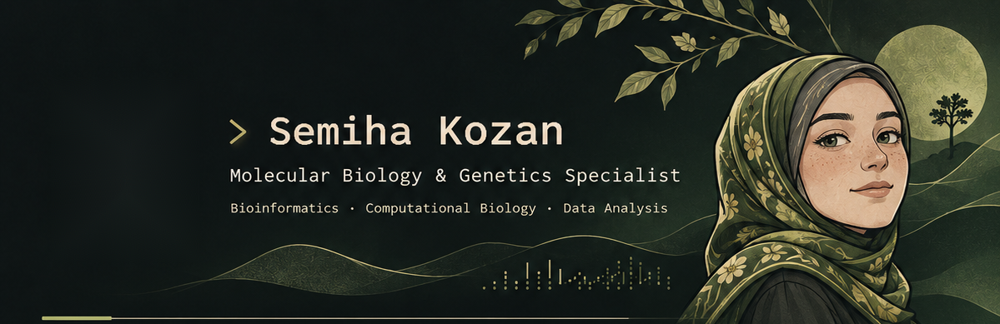
<a href="mailto:semihakozann@gmail.com">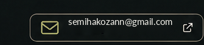</a><a href="https://x.com/GeneToEvidence">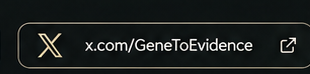</a><a href="https://bsky.app/profile/semihakozann.bsky.social">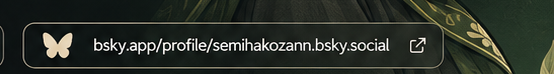</a>
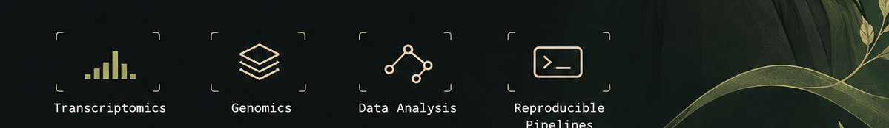
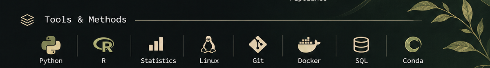
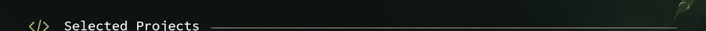
<a href="https://github.com/semihakozann-cell/RNA-seq-analysis">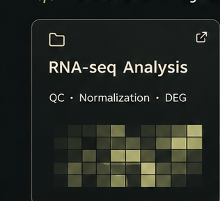</a><a href="https://github.com/semihakozann-cell/rna-seq-cancer-analysis">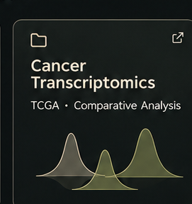</a><a href="https://github.com/semihakozann-cell/moonlighting-protein-analysis">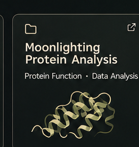</a><a href="https://github.com/semihakozann-cell/teyzosmetre">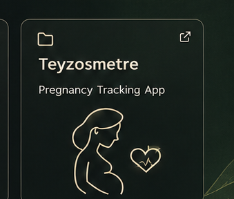</a>
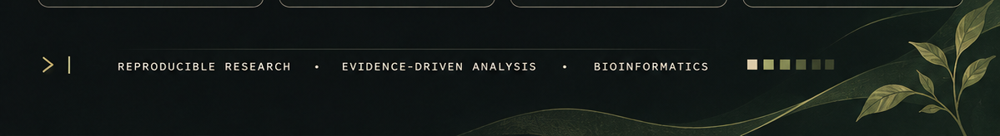

  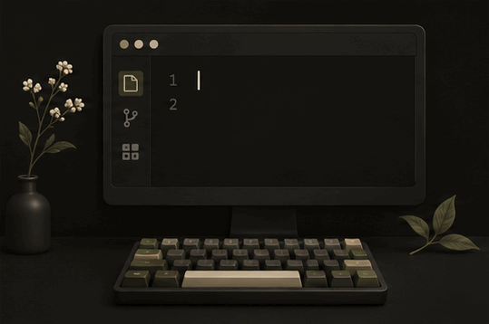

  <picture>
    <source media="(prefers-color-scheme: dark)"
      srcset="https://raw.githubusercontent.com/semihakozann-cell/semihakozann-cell/output/pacman-contribution-graph-dark.svg">
    <source media="(prefers-color-scheme: light)"
      srcset="https://raw.githubusercontent.com/semihakozann-cell/semihakozann-cell/output/pacman-contribution-graph.svg">
    
  </picture>

