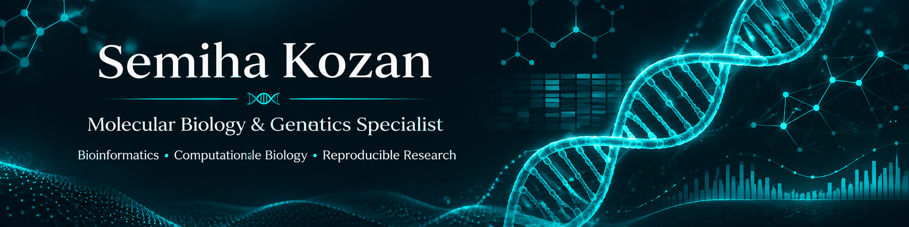
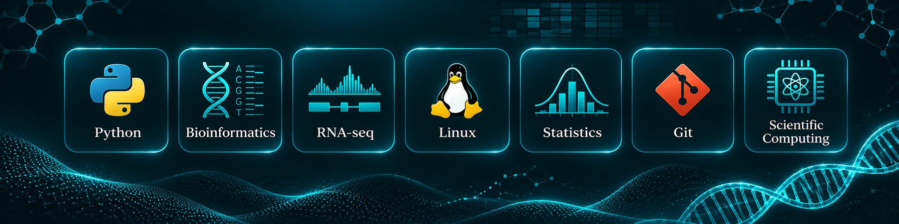
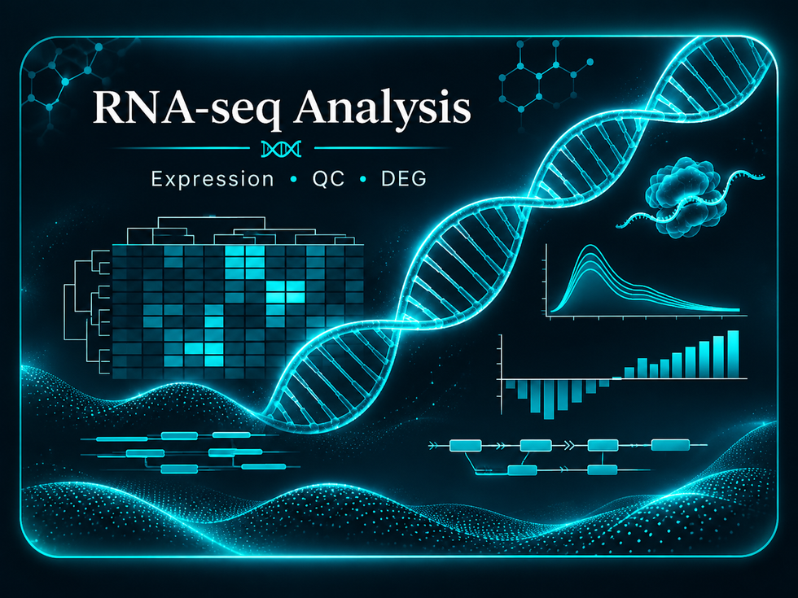
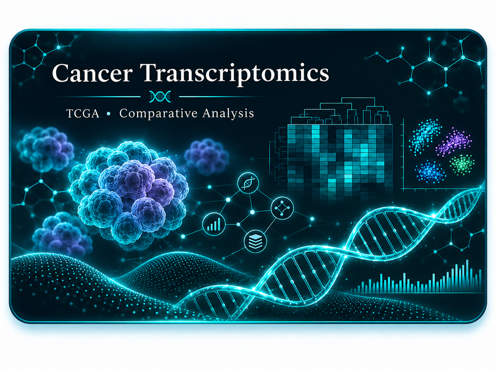
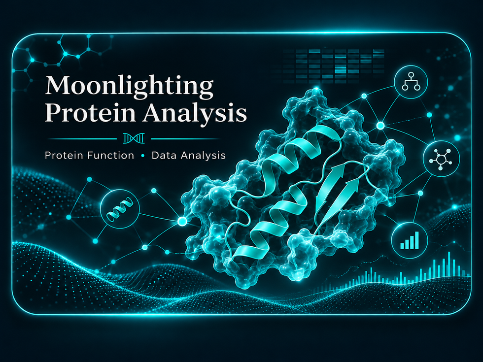
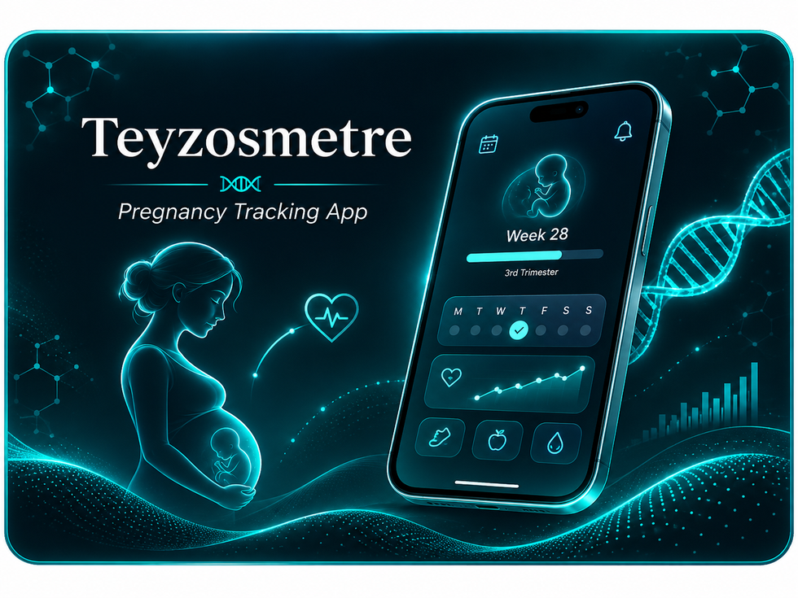
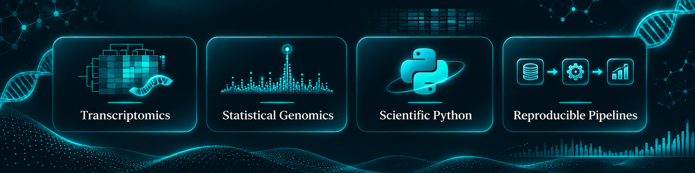
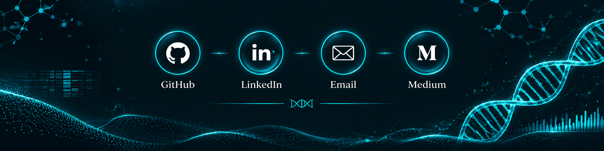

<!-- Visual-first portfolio | Semiha Kozan -->

 

 

<!-- Featured projects: each image links to a real repository. -->

 

 

<!-- Footer is decorative; do not mistake the icons within the image for clickable links. -->

